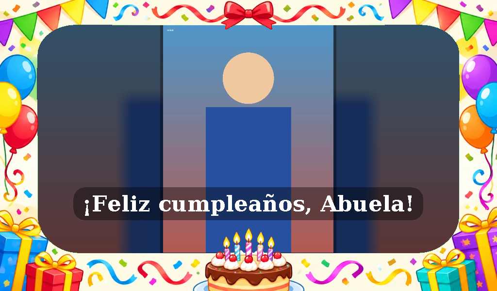
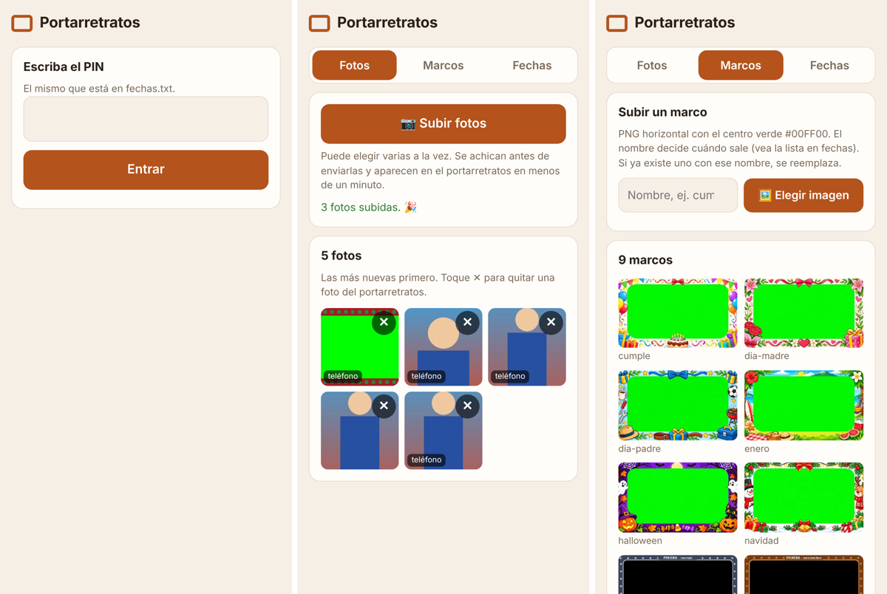
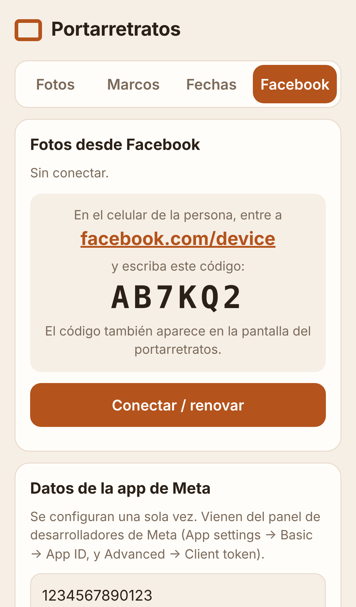
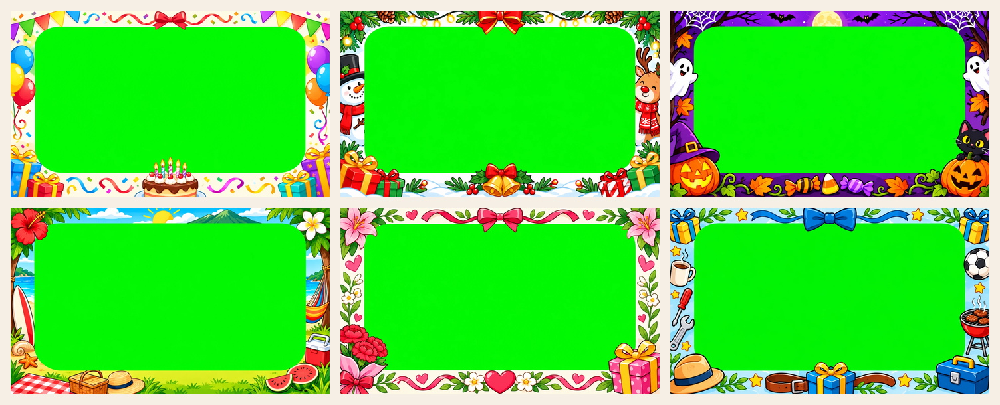

# PortaRetratos

**Turn an old Android tablet into a digital photo frame** that changes its frame by date and gets new photos on its own — from **Facebook** or from your **phone**.

*[Versión en español](README.md)* · The app's interface is in Spanish.

It started as a gift for a grandmother who only uses Facebook: she keeps posting photos as always, and they show up on the frame by themselves.

## Features

- 🖼️ **Date-based frames:** birthdays with the person's name, holidays, seasons (all of December is Christmas) and one frame per month.
- 📘 **Photos from Facebook:** every hour it fetches the new photos a person uploads. Connecting takes a code at `facebook.com/device`, like a smart TV. Access lasts ~60 days and the tablet asks for renewal by itself.
- 📱 **Web page for your phone** (same Wi‑Fi, PIN-protected): upload/remove photos, upload frames, edit birthdays and dates, update the app.
- 🧍 **Portrait photos done right:** shown whole over a blurred background; landscape photos fill the frame.
- 🌙 **Night mode**, auto-start on boot, keeps the screen on.
- 🧓 **Runs on very old tablets:** **Android 4.4+ (2013)**. No Google Play, no accounts, no cloud servers.

| Phone page | Connect Facebook | Included frames |
|---|---|---|
|  |  |  |

## Install

1. On the tablet: **Settings → Security → Unknown sources** (enable).
2. Download **`PortaRetratos.apk`** from [Releases](https://github.com/grodrigonza-design/PortaRetratos/releases/latest) and install it. If the tablet's browser can't download it, transfer it from a computer: run `python -m http.server 8000` in its folder and open `http://PC-IP:8000/PortaRetratos.apk` on the tablet (same network), or use USB, an SD card or Bluetooth.
3. Open **PortaRetratos**. The screen shows an address like `http://192.168.1.25:8080`.
4. Open it **on your phone**, create a PIN and upload photos.

Tip: enable **Developer options → Stay awake** (screen stays on while charging) and set **Screen lock → None**.

## Facebook photos

Each user creates **their own free Meta app** (about 15 minutes), kept in **Development mode**. Making a single app work for everyone would require Meta's official review of the photos permission. Step-by-step guide (Spanish, with an English summary): **[docs/FACEBOOK.md](docs/FACEBOOK.md)**.

## Frames

Make your own with ChatGPT or another image AI: a landscape PNG with a **pure green `#00FF00` center**. The app turns the green transparent and places the greeting so it doesn't cover the decorations. Prompt and file names: [docs/MARCOS.md](docs/MARCOS.md).

## Build

GitHub Actions builds the APK (`.github/workflows/apk.yml`) and publishes a Release for every `v*` tag. Signing uses the repository secrets `SIGNING_KEYSTORE_B64` (base64 keystore) and `SIGNING_PASSWORD`; the key is never committed. If you fork the project, create your own key with `keytool`.

## License

[MIT](LICENSE)
