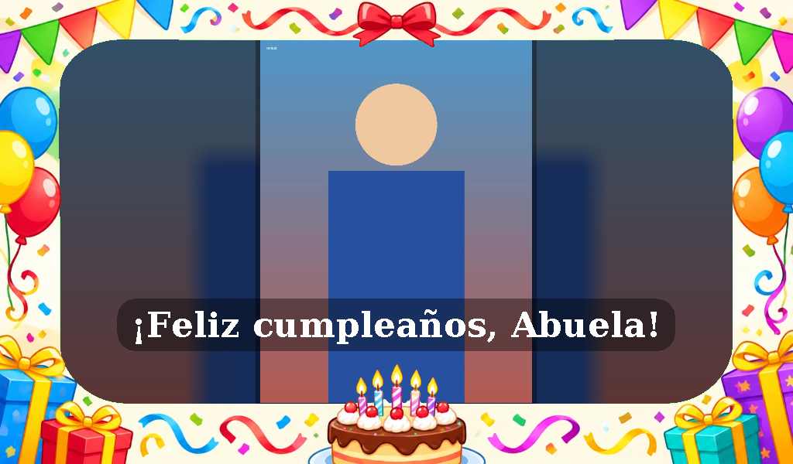
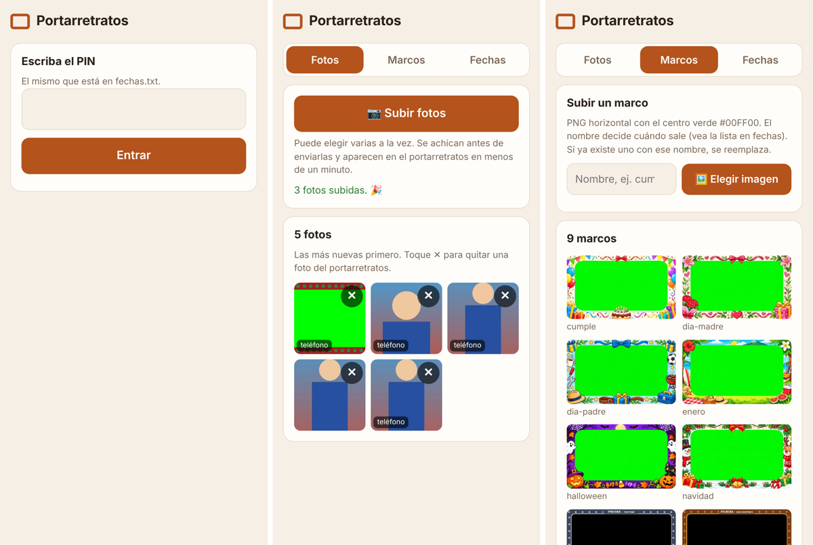
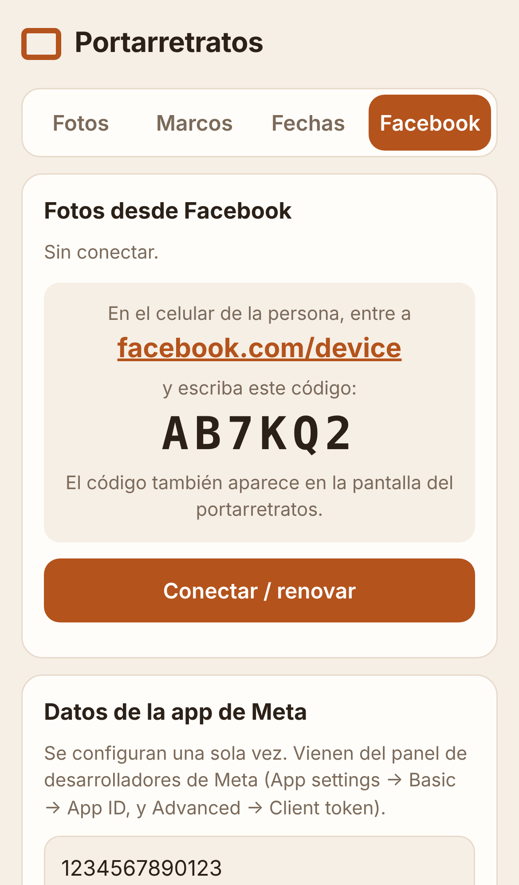
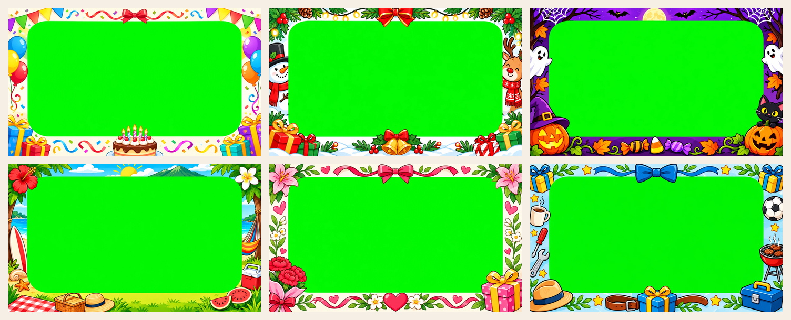

# PortaRetratos

**Convierte una tablet Android vieja en un portarretratos digital** que cambia de marco según la fecha y recibe fotos solo: desde **Facebook** o desde el **celular**.

*[English version](README.en.md)*



Nació como un regalo para una abuela que solo usa Facebook: ella sigue subiendo sus fotos como siempre y aparecen solas en el portarretratos. Nadie tiene que estar pasándole fotos.

## Qué hace

- 🖼️ **Marcos según la fecha:** cumpleaños con el nombre de la persona, feriados, temporadas (todo diciembre navideño) y un marco por mes.
- 📘 **Fotos desde Facebook:** cada hora trae las fotos nuevas que la persona sube. Para conectarla basta un código en `facebook.com/device`, como en los televisores. Se renueva cada ~2 meses y la tablet avisa sola.
- 📱 **Página para el celular** (en el mismo WiFi): subir y quitar fotos, subir marcos, editar cumpleaños y fechas, y actualizar la app. Protegida con PIN.
- 🧍 **Fotos verticales bien acomodadas:** se ven completas con un fondo difuminado; las horizontales llenan el marco.
- 🌙 **Modo noche**, arranque automático al encender y pantalla siempre activa.
- 🧓 **Funciona en tablets muy viejas:** desde **Android 4.4 (2013)**. Sin Google Play, sin cuentas y sin servidores en internet.

| Página del celular | Conectar Facebook | Marcos incluidos |
|---|---|---|
|  |  |  |

## Lo que necesita

- Una tablet Android **4.4 o más nueva**, conectada al cargador.
- WiFi.
- Para Facebook: una cuenta de Facebook para crear una "app de Meta" gratuita. Toma unos 15 minutos y se hace una sola vez; ver [la guía de Facebook](docs/FACEBOOK.md).

## Instalación

1. En la tablet: **Ajustes → Seguridad → Orígenes desconocidos** (activar).
2. Descargue **`PortaRetratos.apk`** desde [Releases](https://github.com/grodrigonza-design/PortaRetratos/releases/latest) e instálelo. Si el navegador de la tablet no logra descargarlo, vea [Problemas comunes](#problemas-comunes).
3. Abra **PortaRetratos**. La pantalla muestra una dirección como `http://192.168.1.25:8080`.
4. Abra esa dirección **en su celular** (conectado al mismo WiFi), **cree un PIN** y suba fotos.

Recomendado para que nunca se apague:
- **Pantalla activa:** Ajustes → Acerca del tablet → toque 7 veces **Número de compilación** → Opciones de desarrollador → **Pantalla activa** (no se apaga mientras carga).
- **Ajustes → Seguridad → Bloqueo de pantalla → Ninguno.**

## Uso

- **Tocar la pantalla:** pasa a la siguiente foto y muestra información (qué marco y por qué, dirección para el celular, estado de Facebook).
- **Página del celular** (`http://IP-de-la-tablet:8080`):
  - **Fotos:** subir varias a la vez (se achican antes de enviarlas) o quitar con ✕.
  - **Marcos:** subir un PNG con el nombre que corresponde (ej. `navidad`).
  - **Fechas:** cumpleaños, feriados y ajustes; además, **actualizar la app**.
  - **Facebook:** conectar, renovar, buscar fotos ahora y filtrar por álbum.

### Cumpleaños y fechas

Se editan en la pestaña **Fechas**:

```
cumple 11/08 = Papá                         ← cumpleaños (día/mes = nombre)
cumple 03/05 = Abuela | cumple-abuelos      ← con un marco propio
fecha 25/12 = navidad | ¡Feliz Navidad!     ← fecha = marco | texto
fecha SEMANA_SANTA = semana-santa           ← se calcula sola cada año
fecha DIA_DEL_PADRE = dia-padre             ← tercer domingo de junio
temporada 01/12-31/12 = navidad             ← rango de fechas
mes noviembre = noviembre                   ← marco del mes
noche = 22:30-06:00                         ← pantalla oscura de noche
```

Prioridad: **cumpleaños → fecha → temporada → mes → normal**. Si dos personas cumplen el mismo día, salen juntas: "¡Feliz cumpleaños, Ana y Luis!". El archivo de ejemplo trae los feriados de Costa Rica; cámbielos por los de su país.

### Marcos

Vienen 6 marcos de ejemplo. Puede hacer los suyos con ChatGPT u otra IA: PNG horizontal con el **centro de color verde puro `#00FF00`**. La app lo vuelve transparente sola y acomoda el mensaje para no tapar los adornos. Guía, prompt y lista de nombres: [docs/MARCOS.md](docs/MARCOS.md).

## Fotos desde Facebook

Guía paso a paso: **[docs/FACEBOOK.md](docs/FACEBOOK.md)**. En resumen:

1. Crear una app gratuita en **developers.facebook.com**, con inicio de sesión desde dispositivos y el permiso `user_photos`. Se deja en **modo desarrollo**, sin revisión de Meta.
2. Agregar a la persona como **Evaluador**; ella acepta la invitación una vez.
3. Poner el **App ID** y el **Client Token** en la pestaña Facebook.
4. La persona escribe el código que muestra la tablet en **facebook.com/device**. Listo.

> Cada quien usa **su propia app de Meta**. Para que una sola app sirviera a cualquier persona, Meta exige revisión oficial del permiso de fotos.

## Problemas comunes

<details>
<summary><b>El navegador de la tablet no descarga el APK</b></summary>

Los Android viejos a veces no logran conectarse a GitHub. Descárguelo en una computadora y páselo con cualquiera de estas opciones:
- **Por WiFi desde la PC:** en la carpeta donde está el APK, abra una terminal y ejecute `python -m http.server 8000`. En la tablet abra `http://IP-de-la-PC:8000/PortaRetratos.apk`. La PC y la tablet deben estar **en la misma red**: los tres primeros números de la IP iguales.
- **Cable USB:** en la notificación de USB de la tablet, elija *Transferencia de archivos (MTP)*.
- **Tarjeta SD** o **Bluetooth**.

Una vez instalada, las siguientes versiones se instalan desde la página del celular (**Fechas → Actualizar la app**).
</details>

<details>
<summary><b>La pantalla se apaga</b></summary>

Active **Pantalla activa** en Opciones de desarrollador (ver Instalación). Entre las 22:30 y las 06:00 la pantalla se oscurece **a propósito**; se cambia con `noche =` en Fechas.
</details>

<details>
<summary><b>Facebook dice "La app no está activa"</b></summary>

La persona todavía no es **Evaluador** de su app de Meta, o no aceptó la invitación. Ver [docs/FACEBOOK.md](docs/FACEBOOK.md#4-agregar-a-la-persona-como-evaluador).
</details>

<details>
<summary><b>La página del celular no abre</b></summary>

El celular tiene que estar en el **mismo WiFi** que la tablet. Toque la pantalla de la tablet para ver la dirección actual; puede cambiar si el router le da otra IP.
</details>

## Privacidad

- Todo queda **en la tablet**. No hay servidores intermedios.
- El permiso de Facebook solo permite **leer las fotos** de la persona que se conectó, y se puede quitar cuando quiera desde Facebook (Configuración → Apps y sitios web).
- La página del celular solo funciona dentro de la red de la casa y pide PIN.

## Compilar

El APK se compila solo con GitHub Actions (`.github/workflows/apk.yml`) y se publica en Releases al crear una etiqueta `v*`. Para compilar localmente: Android SDK + JDK 17 + Gradle 8.7 → `gradle assembleDebug`.

**Firma:** la llave no está en el repositorio. Si hace su propia copia (fork), cree la suya con `keytool` y guárdela como secretos del repositorio:
- `SIGNING_KEYSTORE_B64`: el archivo `.keystore` en base64.
- `SIGNING_PASSWORD`: su contraseña.

Use siempre la misma llave para que las actualizaciones se instalen encima.

## Licencia

[MIT](LICENSE): úselo, modifíquelo y compártalo libremente.
